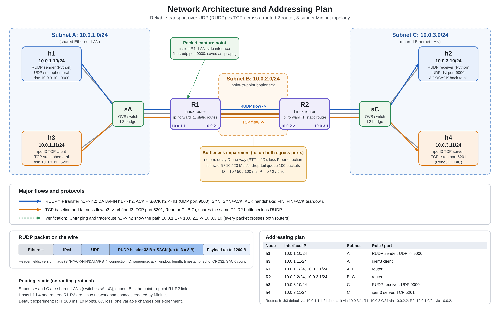

# Reliable UDP (RUDP) Technical Report

**Repository:** `GhufranMianoor/RUDP`
**Report date:** *[fill in on submission]*
**Team:** *[names and roll numbers]*

## 1. Objective

This project implements a reliable, connection-oriented transport over UDP and
evaluates it against TCP Reno and TCP CUBIC. The POC is intended to demonstrate
connection setup and teardown, sequence-based data transfer, acknowledgements,
selective acknowledgements (SACK), retransmission, congestion control, RTT
estimation, flow control, and integrity validation.

## 2. System architecture

The experimental topology uses two Linux routers and four end hosts. The
left hosts use `10.0.1.0/24`, the router WAN uses `10.0.2.0/24`, and the right
hosts use `10.0.3.0/24`. Full interface addresses and static routes are listed
in [docs/ARCHITECTURE.md](docs/ARCHITECTURE.md). RUDP data uses UDP 9000;
the TCP baseline uses Linux TCP (Reno or CUBIC) on TCP 5201, through
`apps/tcp_bulk.py`; iperf3 is used only for the topology's rate check.



*Figure 1: subnets, addresses, ports, switches, routers, impairment point, capture point and flows.*

Linux IP forwarding and static routes provide end-to-end reachability.
`tc netem` injects delay and packet loss on both egress interfaces of the R1-R2
link (delay is one-way, so RTT = 2 x delay; loss is per direction), and a child
TBF qdisc creates the bottleneck rate with a 100-packet drop-tail queue. The
routers therefore act as measurable impairment points rather than as switches only.
Subnets A and C are shared LANs built from Open vSwitch bridges.

## 3. RUDP protocol design

### 3.1 Packet format

RUDP is an application-layer protocol carried in UDP datagrams to port 9000.
Every datagram starts with a 32-byte, network-order header (Python `struct`
format `>BBHIIHHIIIB3x`), followed by 0 to 3 SACK blocks of 8 bytes and up to
1200 bytes of payload. With IPv4 (20 B) and UDP (8 B) headers, a full data
packet is 1260 bytes, below the 1500-byte Ethernet MTU, so IP never fragments.

| Offset | Size | Field | Meaning |
|---|---|---|---|
| 0 | 1 B | Version | Always 1; other versions are rejected |
| 1 | 1 B | Flags | SYN 0x01, ACK 0x02, FIN 0x04, DATA 0x08, RST 0x10 |
| 2 | 2 B | Connection ID | Random per connection; packets with another ID are ignored |
| 4 | 4 B | Sequence | Packet number of a DATA packet (first data packet = 1); the FIN carries the next unused number |
| 8 | 4 B | Acknowledgement | Cumulative: the next packet number the receiver expects |
| 12 | 2 B | Window | Free receive-buffer slots, in packets (flow control) |
| 14 | 2 B | Payload length | Bytes of payload; must match the datagram length |
| 16 | 4 B | Timestamp | Sender clock in ms when this copy was sent |
| 20 | 4 B | Timestamp echo | Timestamp of the packet that triggered this ACK |
| 24 | 4 B | CRC32 | Over header (with this field zeroed), SACK blocks and payload |
| 28 | 1 B | SACK count | Number of SACK blocks that follow (0 to 3) |
| 29 | 3 B | Reserved | Zero |
| 32 | 8 B each | SACK blocks | Inclusive `(start, end)` ranges received above the cumulative ACK |

Sequence numbers count packets, not bytes. This keeps the SACK scoreboard and
the window arithmetic in whole packets, which is also the unit of cwnd. A
packet that fails the CRC32, has an unknown version, or whose lengths do not
add up is dropped silently, exactly as if the network had lost it, so
corruption is handled by the normal loss-recovery path.

### 3.2 Connection set-up and teardown

1. **Handshake.** The sender sends SYN with a random 16-bit connection ID. The
   receiver adopts that ID and answers SYN+ACK; the sender completes with ACK
   and starts sending data. A lost SYN or SYN+ACK is covered by retransmitting
   the SYN (up to 7 times, waiting 1 s, 2 s, then 4 s). A lost final ACK does
   no harm, because the first DATA packet also proves the connection is open.
   The SYN/SYN+ACK round trip, if the SYN was not retransmitted, seeds the RTO
   estimator (Karn's rule).
2. **Teardown.** When every data packet is acknowledged, the sender sends FIN
   carrying the next sequence number. The receiver accepts it only when it has
   delivered everything before that number (otherwise it re-ACKs and keeps
   waiting for the missing data), answers FIN+ACK, and lingers 1.5 s, answering
   any retransmitted FIN, so a lost FIN+ACK cannot strand the sender (a short
   TIME_WAIT). The FIN is retransmitted up to 8 times.
3. **Giving up.** A sender with no progress for 30 s and a receiver that hears
   nothing for 30 s both exit with an error, so no experiment can hang.

## 4. Reliability, flow control and congestion control

### 4.1 Selective Repeat with SACK

The sender keeps every transmitted but unacknowledged packet in an
*outstanding* table. A packet leaves the table when the cumulative ACK passes
it or a SACK block covers it; SACKed numbers are also kept in a sorted
*scoreboard*. The receiver buffers out-of-order packets inside its window,
delivers in order as soon as a hole is filled, and reports up to three SACK
ranges per ACK, the most recently changed first (as in RFC 2018), so that
over several ACKs the sender learns about every range even when there are
more than three holes.

A packet is declared **lost** in one of two ways:

- **Fast retransmit (SACK-based).** At least three packets sent after it have
  been SACKed. This is the SACK equivalent of TCP's three duplicate ACKs. A
  retransmission that is itself lost is detected the same way, counting only
  packets sent after the retransmission.
- **Retransmission timeout (RTO).** The packet has been outstanding longer than
  the RTO.

Lost packets stop counting as "in flight" and wait in a queue until the
congestion window allows them to be sent again, so a timeout does not turn into
a full-window burst while cwnd is 1. The classic duplicate-ACK counter of RFC
5681 is implemented too, but because every ACK above a hole carries SACK
blocks, in practice all fast retransmits come from the scoreboard.

### 4.2 Flow control

Every ACK advertises the number of free slots in the receiver's reorder buffer
(window size minus buffered out-of-order packets). The sender keeps at most
min(cwnd, advertised window) packets in flight and never lets the distance
between the oldest unacknowledged packet and the next new one exceed the
window. When the advertised window is 0 it sends a single probe packet so a
window update cannot be lost forever. The default window is 1024 packets
(1.2 MB), above the largest bandwidth-delay product tested (20 Mbit/s x 200 ms
= 500 kB), so in the experiments cwnd is the limit. The `flow-control` capture
uses a 16-packet window to show the advertised window limiting the sender.

### 4.3 Congestion control (Reno, RFC 5681)

| State | On each newly acknowledged packet | On loss |
|---|---|---|
| Slow start (cwnd < ssthresh) | cwnd += 1 | see below |
| Congestion avoidance | cwnd += 1/cwnd (about +1 per RTT) | see below |
| Fast recovery | cwnd held at ssthresh | a new loss event halves again |

- **Fast retransmit / fast recovery.** On a SACK-detected loss, ssthresh =
  max(2, cwnd/2) and cwnd = ssthresh. This happens **once per window of data**:
  further losses among packets sent before the loss was detected belong to the
  same event. Recovery ends when the cumulative ACK passes the highest packet
  sent when the event began. A loss among packets sent after that point is a
  new congestion event and halves cwnd again.
- **Timeout.** ssthresh = max(2, cwnd/2), cwnd = 1, back to slow start, RTO
  doubled. All packets that expire within one timeout episode (sent before
  the first expiry was detected) count as **one** event.
- **Start.** cwnd = 1 packet and ssthresh = the window cap, so slow start runs
  until the first loss, as in TCP.

Every change of cwnd, ssthresh or state is written to a JSON-lines event log,
which produces the cwnd plots. Logging is buffered in memory and written in
batches, so it does not slow the sender down.

### 4.3.1 CUBIC variant (RFC 8312 / RFC 9438)

`CubicController` (`send_file.py --cc cubic`) keeps slow start, SACK recovery
and the timeout response of the Reno controller and changes two things:

- **Loss response.** ssthresh = cwnd = max(2, 0.7 cwnd) (beta = 0.7 instead of
  0.5); the window at the loss is remembered as W_max. With fast convergence,
  a loss below the previous W_max lowers W_max to W_max (1 + beta) / 2.
- **Window growth in congestion avoidance** follows
  W(t) = C (t - K)^3 + W_max with C = 0.4 and K = cbrt(W_max (1 - beta) / C),
  where t is the time since the first ACK after recovery: fast (concave)
  growth back towards W_max, a plateau around it, then accelerating (convex)
  probing beyond it. Growth is independent of RTT, unlike Reno's +1 packet
  per RTT. In the TCP-friendly region an estimate of Reno's window,
  growing 3 (1 - beta)/(1 + beta) packets per RTT, is used when it is larger.

Unit tests (`tests/test_cubic.py`) check the 0.7 reduction, fast convergence,
the return to W_max after K seconds, convex growth beyond it, the TCP-friendly
region and the timeout response with a simulated clock.

### 4.4 RTT estimation and RTO (RFC 6298)

The sender records the send time of each packet. When a packet that was sent
exactly once is acknowledged, the elapsed time is an RTT sample (Karn's
algorithm discards samples from retransmitted packets, whose ACK is
ambiguous). The estimator follows RFC 6298: SRTT and RTTVAR with gains 1/8
and 1/4, RTO = SRTT + max(G, 4 x RTTVAR) with G = 0.2 s, clamped to [0.2 s, 5 s];
the initial RTO is 1 s. A timeout doubles the RTO until a new valid sample
arrives. G is the clock granularity in RFC 6298, but because RUDP samples every
ACK, RTTVAR decays to about 1 ms on a steady path and RTO fell to SRTT + 1 ms.
In the first lab run at 200 ms RTT and 0% loss, a retransmission queued behind
a full bottleneck queue (up to 120 ms) then timed out spuriously over and over,
and cwnd stayed below 50 packets. With a 0.2 s margin (as Linux TCP uses) the
same 200 ms path on our localhost bottleneck emulator went from 1.7 to 6.0 Mbit/s
(Reno) and from 3.1 to 7.3 Mbit/s (CUBIC), with timeouts falling from 17 and 11 to
1 and 0; at 2% and 5% random loss goodput was unchanged.

### 4.5 Design choices

- **Packet-numbered sequence space.** Simpler SACK and window arithmetic than
  byte numbering; payloads are fixed at 1200 bytes except the last one.
- **SACK instead of plain Go-Back-N or ACK-per-packet.** Selective Repeat
  needs to know which packets arrived; cumulative ACK plus SACK ranges gives
  that in one small ACK and still works when ACKs are lost.
- **Once-per-window congestion response.** Without it, a burst of drops at the
  bottleneck queue (for example at the end of slow start) would cut cwnd
  repeatedly for what is one congestion signal. During development this was
  measured directly: counting each expired packet as a separate timeout cut
  goodput on an emulated 10 Mbit/s, 100 ms path from 7.2 to 3.5 Mbit/s.
- **Timestamps on the wire.** Each copy, including retransmissions, carries a
  fresh timestamp and ACKs echo it. RTT is sampled from local send times; the
  fields make retransmissions and ACK timing easy to read in captures.

## 5. POC implementation

| Component | File | Role |
|---|---|---|
| Packet codec | `rudp/packet.py` | Header, SACK blocks, CRC32 encode/decode |
| Sender | `rudp/sender.py` | Outstanding table, SACK scoreboard, loss detection, timers |
| Receiver | `rudp/receiver.py` | Reorder buffer, cumulative ACK, SACK ranges, advertised window |
| Congestion control | `rudp/controller.py` | Reno state machine and RTO estimator |
| RTT sampling | `rudp/rtt.py` | Karn-filtered RTT samples and statistics |
| Connection | `rudp/connection.py` | Handshake, send loop, FIN/linger, time-outs |
| Applications | `apps/send_file.py`, `apps/recv_file.py` | File transfer over RUDP; `--progress` prints cwnd live |
| Topology | `topology/topo.py` | Mininet network, routes, `tc` impairments, `--check` |
| Live demo | `tools/live_demo.py` | Routes, traceroute, transfer with loss/delay changed mid-run, cwnd plot |

The live demonstration is one command:

```bash
sudo .venv/bin/python tools/live_demo.py --pause
```

It prints the interfaces and routing tables of h1, h2, R1 and R2 and the
bottleneck qdiscs, runs traceroute h1 -> h2 (10.0.1.1 -> 10.0.2.2 ->
10.0.3.10), then transfers a 30 MiB file while printing cwnd, ssthresh,
state, RTO and progress every 0.5 s. At 10 s it adds 2% loss and at 20 s it
raises the RTT from 50 ms to 200 ms, so the audience sees cwnd halve under
loss and grow more slowly at the longer RTT. It ends with matching SHA-256
hashes and a cwnd plot with the phase changes marked.

## 6. Packet capture evidence

```bash
sudo .venv/bin/python tools/capture_evidence.py
```

records five traces inside R1 on its LAN-side interface (the sender's side of
the bottleneck, where originals, retransmissions and returning ACKs are all
visible):

| Trace | Network | What it shows |
|---|---|---|
| `handshake.pcapng` | RTT 50 ms, no loss | SYN, SYN+ACK, ACK and the first DATA packets |
| `loss-recovery.pcapng` | RTT 100 ms, 2% loss | ACKs with SACK ranges around a hole, then the retransmission |
| `window-growth.pcapng` | RTT 100 ms, no loss | DATA bursts doubling every RTT (slow start), then linear growth |
| `teardown.pcapng` | RTT 50 ms, no loss | FIN carrying the next sequence number, FIN+ACK |
| `flow-control.pcapng` | RTT 100 ms, 1% loss, window 16 | At most 16 DATA packets in flight; the ACK window field shrinking while holes are open |

[tools/rudp_dissector.lua](tools/rudp_dissector.lua) decodes them in
Wireshark (filter prefix `rudpcn`; Wireshark's built-in "RUDP" is a different
protocol). Annotated screenshots are in `results/evidence/`; see
[docs/SCREENSHOT_CHECKLIST.md](docs/SCREENSHOT_CHECKLIST.md) for what each one
must label.

1. SYN / SYN+ACK / ACK handshake - *[figure]*
2. DATA, ACK with SACK ranges, and the retransmission - *[figure]*
3. DATA bursts growing per round trip (slow start) - *[figure]*
4. FIN / FIN+ACK teardown - *[figure]*
5. Window-limited sending with a 16-packet receive window - *[figure]*

## 7. Experimental method

Each condition runs in a freshly built network with a fixed 100-packet
drop-tail queue at the bottleneck. Every run sends one 10 MiB file
(deterministic pseudo-random content, SHA-256 checked for RUDP) with RUDP Reno
(h1 to h2, UDP 9000), then TCP Reno and TCP CUBIC with `apps/tcp_bulk.py` (h3 to h4, TCP
5201). Before each run, 20 ping probes from h1 to h2 on the idle path give an
RTT measured independently of RUDP. Three runs per condition; tables report
mean and standard deviation.

| Experiment | Condition (others: RTT 100 ms, 10 Mbit/s, 0% loss) | Metrics |
|---|---|---|
| Exp1 | 0%, 2%, 5% loss per direction | Goodput, retransmissions, completion time |
| Exp2 | 20 ms, 100 ms, 200 ms RTT | Goodput, RUDP RTT estimate vs RTT measured by ping |
| Exp3 | 5, 10, 20 Mbit/s bottleneck | Goodput, cwnd over time, RTT estimate above minimum RTT (queueing delay) |
| Exp4 | RUDP **concurrently** with TCP Reno, and with TCP CUBIC, on 10 Mbit/s at RTT 20, 100, 200 ms | Per-flow throughput, share of the bottleneck, Jain's fairness index |

The comparison with TCP Reno and CUBIC (proposal experiment 4) is part of
every Exp1 to Exp3 condition; the fairness test (proposal experiment 5) is
Exp4 here.

**Metrics.** RUDP goodput is payload bytes divided by the time from the end of
the handshake to the acknowledged FIN. TCP goodput is defined the same way: payload
bytes divided by the receiver-measured time from accepting the connection to the
last byte (`apps/tcp_bulk.py`). We first used `iperf3 -n`, but it ends the test
when the sender has written the bytes into its socket; with Linux's
multi-megabyte send buffer most of a 2 MiB payload was still unsent, and the
receiver had counted only 12-87% of it. Also recorded: completion time,
retransmissions (RUDP retransmitted packets; TCP `tcpi_total_retrans` from the sender's `TCP_INFO`),
and RUDP smoothed and minimum RTT. Failed transfers are kept in `raw.csv` and
excluded from means. Every RUDP run writes an event log.

**Fairness.** Both flows start together and send 10 MiB each. Throughput is
measured for both over the **same window**, from when both are delivering to
when the first one finishes: for RUDP from the acknowledgement times in its
event log, for TCP from the TCP receiver's 0.5 s intervals. Jain's index is
J = (x1 + x2)^2 / (2 (x1^2 + x2^2)), 1 for an equal split and 0.5 when one
flow takes everything. Measuring each flow over its own duration instead
would over-state fairness, because the flow that finishes second has the link
to itself at the end; that value is kept in `raw.csv` as
`fairness_index_own_duration` for comparison only.

The complete matrix runs with `sudo scripts/run_all.sh`. `results/raw.csv` has
one row per transfer and `results/summary.csv` the mean and standard deviation
per condition.

## 8. Results

> **NOT YET MEASURED.** This section must be filled from `results/summary.csv`
> after running the matrix on the lab machine (`python analysis/make_report_tables.py
> --results results` prints the tables). Do not write numbers that are not in
> `summary.csv`.

*[Table and figure for Exp1: goodput versus loss]*
*[Table and figure for Exp2: goodput versus RTT, and RTT estimate versus RTT measured by ping]*
*[Table and figure for Exp3: goodput versus bottleneck rate]*
*[Table and figure for Exp4: RUDP's share and Jain's index (mean +/- sd, range) against TCP Reno and TCP CUBIC at three RTTs; `fairness_vs_rtt.png`]*
*[Figure: cwnd and ssthresh over time showing slow start, the sawtooth, and any timeout]*

### 8.1 Discussion

*[To write from the measured data: how goodput falls with loss and why (Reno's
response to loss, ACK loss because loss is per direction); behaviour at long RTT;
whether RUDP approaches the bottleneck rate at 0% loss; how the RTT estimate compares
with the RTT measured by ping plus queueing (the 100-packet queue adds up to 240 ms at
5 Mbit/s); how RUDP shares the link with TCP Reno and with TCP CUBIC and whether the
fairness index supports "TCP-friendly"; if `--rudp-cc reno cubic` was run, how the
RUDP CUBIC controller compares with RUDP Reno, especially at 200 ms RTT.]*

## 9. Reproduction procedure

```bash
git clone https://github.com/GhufranMianoor/RUDP.git
cd RUDP
sudo scripts/setup_ubuntu.sh
.venv/bin/python -m pytest -q
sudo scripts/run_all.sh
```

## 10. Validation and limitations

**Tests.** 87 automated tests (`tests/`) cover packet encoding and corruption,
the sender scoreboard and receiver state, RTT and Karn's rule, Reno
transitions including one response per loss event and per timeout episode,
the overlap-window fairness calculation, and localhost transfers through an
impairment proxy with loss, duplication, reordering, corruption, and loss of
SYN, SYN+ACK, FIN and FIN+ACK. A 10 MiB x 10-run soak at 0%, 2% and 5% loss
passed all SHA-256 checks.

**Limitations.**

- Loss is applied in both directions, so ACKs are lost as well as data.
- RTT is sampled from local send times, not from the timestamp echo. Packets
  acknowledged cumulatively after a hole fills, and not SACKed before, can give
  samples that include the recovery time.
- TCP completion time starts when the receiver accepts the connection, RUDP's
  after its handshake; both exclude connection setup (Section 7).
- The fairness window is aligned to the TCP client's launch time, so it can
  be early by about one connection set-up time; this is small against a
  multi-second window.
- RUDP runs in user-space Python. On the test machine it reached well above
  20 Mbit/s on localhost, so the bottleneck, not the CPU, limits throughput in
  these experiments; it would not keep up with gigabit links.
- Mininet, `tc`, dumpcap and iperf3 need a root Ubuntu environment.

## 11. Individual contributions

| Member | Roll no. | What this person did |
|---|---|---|
| *[name]* | *[no.]* | *[specific components, tests, experiments, report sections]* |
| *[name]* | *[no.]* | *[...]* |

*[Fill in with what each person actually did; it must match the repository history.]*

## 12. Use of AI tools

*[Complete with the team's own disclosure.]* Record of AI assistance used in the
repository: see [docs/AI_USE_LOG.md](docs/AI_USE_LOG.md). All AI-generated code and
text must be understood, tested and reviewed by the team before submission.

## 13. Deliverables

- Source POC: `rudp/`, `apps/`
- Topology: `topology/topo.py`
- Experiments: `experiments/run_experiments.py`; analysis: `analysis/`
- Captures: `tools/capture_evidence.py`; dissector: `tools/rudp_dissector.lua`
- Live demo: `tools/live_demo.py`; screenshot guide: `docs/SCREENSHOT_CHECKLIST.md`
- Localhost stress tools: `tools/lossy_proxy.py`, `tools/loss_soak.py`
- Reproducibility: `README.md`, `scripts/setup_ubuntu.sh`, `scripts/run_all.sh`
- Architecture: `docs/ARCHITECTURE.md`
- Test suite: `tests/`
