**Title:** Reliable Transport over UDP: Selective Repeat with Flow and Congestion Control\
**Course project list:** No. 15 (Reliable data transfer), evaluated against TCP on a routed topology\
**Member 1:** Muhammad Ghufran | Roll No: 24K-0541\
**Member 2:** Ahmed Khan | Roll No: 24K-0629\
**Member 3:** Shayan Khan | Roll No: 24K-0669\
**Repository:** <https://github.com/GhufranMianoor/RUDP>\
**Date of submission:** 24 November 2026

# 1. Introduction and project proposal

UDP delivers datagrams quickly but gives no reliability, ordering, flow control
or congestion control. TCP gives all of these, but inside the kernel, where they
cannot be inspected or changed. Modern transports such as QUIC rebuild them in
user space on top of UDP. We designed and implemented such a transport
ourselves (called RUDP in this report), deployed it across a routed network
with controlled delay, loss and bandwidth, and compared it with TCP Reno and
TCP CUBIC.

**Objectives.** (1) A reliable, in-order transfer protocol over UDP using
Selective Repeat with flow control and congestion control. (2) Deployment over a
2-router, 3-subnet topology, not localhost, with impairments on the router link
(`tc netem` and `tbf`). (3) Measurement of goodput, retransmissions, RTT
estimates and congestion-window behaviour under at least three network
conditions, compared with TCP Reno and CUBIC, including fairness on a shared
bottleneck. (4) Packet captures for every key exchange and a setup that
another group can repeat.

Table 1 maps each item of the approved proposal and of the project
requirements to where it is delivered.

| Requirement | Where it is met |
|---|---|
| 1a-b Title, problem, objectives | Title page and Section 1 |
| 1c, 2 Architecture diagram and addressing plan (subnets, IPs, ports, nodes, routers and switches, flows) | Section 2, Figure 1, Table 2 |
| 1d Protocols and technologies | Section 2.3 |
| 1f, 3 Working POC, shown live | Sections 3 to 5; `tools/live_demo.py`; results in Section 8.2 |
| 4 `.pcapng` per key exchange and annotated figures | Section 6, Figures 2 to 7; `results/pcaps/` |
| 1g, 5 Experiments: 3+ conditions, 3+ runs, mean and spread | Sections 7 and 8 |
| 1h Expected outcomes | Section 9 (compared with what we measured) |
| 1i, team responsibilities | Section 11 |
| 6 Report and reproducible README | This report; `README.md`; Section 10 |

*Table 1: requirements traceability.*

# 2. System architecture

## 2.1 Topology

The network is built in Mininet. Two Linux hosts act as routers (IP forwarding
on, static routes), so every packet from a sender to a receiver crosses both
routers and three subnets. Subnets A and C are shared Ethernet LANs (Open
vSwitch bridges sA and sC); subnet B is the point-to-point R1-R2 link, which
is the bottleneck. A second host pair (h3, h4) carries the TCP baseline and the
competing TCP flow in the fairness test.

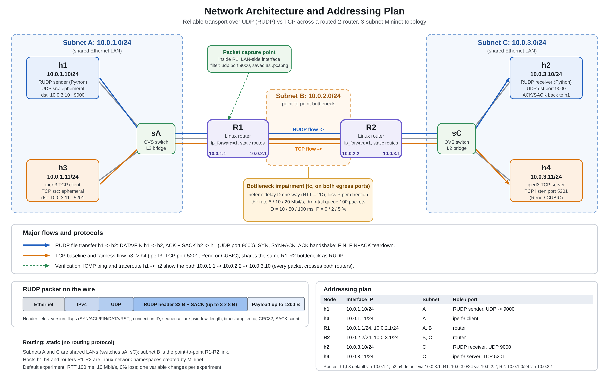{width=100%}

*Figure 1: subnets, addresses, ports, switches, routers, impairment point, capture point and flows.*

| Node | Interface | Address | Subnet | Role and ports |
|---|---|---|---|---|
| h1 | h1-eth0 | 10.0.1.10/24 | A 10.0.1.0/24 | RUDP sender, to UDP 9000 |
| h3 | h3-eth0 | 10.0.1.11/24 | A | TCP sender (Reno or CUBIC) |
| R1 | R1-eth0 / R1-eth1 | 10.0.1.1 / 10.0.2.1 | A / B | Router; netem + tbf on the B side |
| R2 | R2-eth0 / R2-eth1 | 10.0.2.2 / 10.0.3.1 | B / C | Router; netem + tbf on the B side |
| h2 | h2-eth0 | 10.0.3.10/24 | C 10.0.3.0/24 | RUDP receiver, UDP 9000 |
| h4 | h4-eth0 | 10.0.3.11/24 | C | TCP receiver, TCP 5201 |

*Table 2: addressing plan. Each host's default gateway is its router's LAN address; R1 routes 10.0.3.0/24 via 10.0.2.2 and R2 routes 10.0.1.0/24 via 10.0.2.1.*

**Flows.** RUDP data goes from an ephemeral UDP port on h1 to h2:9000; ACKs
return from h2:9000 to that port. The TCP flow runs from h3 to h4:5201. Both
share the R1-R2 link. Captures are taken on R1's LAN-side interface, where the
sender's originals, retransmissions and the returning ACKs are all visible.

## 2.2 Impairment model

On both egress interfaces of the R1-R2 link, `tc netem` is the root qdisc and
adds one-way delay and random loss (so RTT = 2 x delay, and loss applies to
data and ACKs separately), and a child `tbf` qdisc sets the bottleneck rate
with a fixed 100-packet drop-tail queue. The queue size is the same in every
experiment, so differences come only from the variable under test.

## 2.3 Protocols and technologies

UDP carries RUDP; IPv4 static routing; ICMP for ping and traceroute; TCP Reno
and CUBIC as baselines. The protocol is written in Python 3 with standard
sockets. Mininet with Linux network namespaces builds the topology; `tc netem`
and `tbf` impair it; `apps/tcp_bulk.py` and iperf3 measure TCP; `dumpcap`
records traces; a Lua dissector decodes our header in Wireshark; matplotlib
draws the plots. Everything runs in an Ubuntu 24.04 VirtualBox VM.

# 3. RUDP protocol design

## 3.1 Packet format

Every datagram starts with a 32-byte, network-order header (Python `struct`
format `>BBHIIHHIIIB3x`), then 0 to 3 SACK blocks of 8 bytes, then up to 1200
bytes of payload. A full data packet is 1260 bytes with IPv4 and UDP headers,
below the 1500-byte Ethernet MTU, so IP never fragments.

| Offset | Size | Field | Meaning |
|---|---|---|---|
| 0 | 1 B | Version | Always 1; other versions are rejected |
| 1 | 1 B | Flags | SYN 0x01, ACK 0x02, FIN 0x04, DATA 0x08, RST 0x10 |
| 2 | 2 B | Connection ID | Random per connection; other IDs are ignored |
| 4 | 4 B | Sequence | Packet number of a DATA packet (first = 1); a FIN carries the next unused number |
| 8 | 4 B | Acknowledgement | Cumulative: next packet number the receiver expects |
| 12 | 2 B | Window | Free receive-buffer slots, in packets |
| 14 | 2 B | Payload length | Must match the datagram length |
| 16 | 4 B | Timestamp | Sender clock (ms) when this copy was sent |
| 20 | 4 B | Timestamp echo | Timestamp of the packet that triggered this ACK |
| 24 | 4 B | CRC32 | Over header (this field zeroed), SACK blocks and payload |
| 28 | 1 B | SACK count | Number of SACK blocks that follow (0 to 3) |
| 29 | 3 B | Reserved | Zero |
| 32 | 8 B each | SACK blocks | Inclusive (start, end) ranges received above the cumulative ACK |

*Table 3: RUDP header.*

Sequence numbers count packets, not bytes, which keeps the SACK scoreboard,
the window and cwnd in the same unit. A packet that fails the CRC32, has an
unknown version or inconsistent lengths is dropped silently, as if the network
had lost it, so corruption is handled by the normal loss recovery.

## 3.2 Connection set-up and teardown

1. **Handshake.** The sender sends SYN with a random 16-bit connection ID; the
   receiver adopts it and answers SYN+ACK; the sender replies ACK and starts
   sending data. A lost SYN or SYN+ACK is covered by retransmitting the SYN up
   to 7 times (waiting 1, 2, then 4 s). A lost final ACK is harmless because the
   first DATA packet also proves the connection is open. The SYN to SYN+ACK
   time seeds the RTO estimator if the SYN was not retransmitted.
2. **Teardown.** When all data is acknowledged, the sender sends FIN carrying the
   next sequence number. The receiver accepts it only once everything before
   that number is delivered, answers FIN+ACK and lingers 1.5 s answering any
   repeated FIN (a short TIME_WAIT). The FIN is retransmitted up to 8 times.
3. **Giving up.** A sender with no progress for 30 s, or a receiver that hears
   nothing for 30 s, exits with an error, so no experiment can hang.

# 4. Reliability, flow control and congestion control

## 4.1 Selective Repeat with SACK

The sender keeps every unacknowledged packet in an *outstanding* table. A packet
leaves it when the cumulative ACK passes it or a SACK block covers it. The
receiver buffers out-of-order packets inside its window, delivers in order as
soon as a hole fills, and reports up to three SACK ranges per ACK, the most
recently changed first (as in RFC 2018), so the sender learns every range over
a few ACKs even with more than three holes. A packet is declared lost when
**three packets sent after it have been SACKed** (the SACK form of TCP's three
duplicate ACKs, which triggers fast retransmit) or when it has been outstanding
longer than the **RTO**. Lost packets wait in a queue until cwnd allows them
out, so a timeout cannot turn into a full-window burst while cwnd is 1.

## 4.2 Flow control

Each ACK advertises the free slots in the receiver's reorder buffer. The sender
keeps at most min(cwnd, advertised window) packets in flight, and sends a
single probe when the window is 0 so a lost window update cannot stall the
connection. The default window is 1024 packets (1.2 MB), above the largest
bandwidth-delay product tested (20 Mbit/s x 200 ms = 500 kB), so in the
experiments cwnd is the limit. The `flow-control` capture uses a 16-packet
window to show the receiver window limiting the sender.

## 4.3 Congestion control: Reno (RFC 5681) and CUBIC (RFC 9438)

| State | Per newly acknowledged packet | On loss |
|---|---|---|
| Slow start (cwnd < ssthresh) | cwnd += 1 | Fast retransmit: ssthresh = cwnd = max(2, cwnd/2), enter fast recovery |
| Congestion avoidance | cwnd += 1/cwnd (about +1 per RTT) | as above |
| Fast recovery | cwnd held at ssthresh | Ends when the cumulative ACK passes the highest packet sent at the loss |
| Any (timeout) | | ssthresh = max(2, cwnd/2), cwnd = 1, RTO doubled, back to slow start |

*Table 4: Reno state machine. Start: cwnd = 1, ssthresh = window cap.*

The response to loss happens **once per window**: further losses among packets
sent before the loss was detected belong to the same congestion event, and all
packets that expire in one timeout episode count as one timeout. Without this, a
burst of drops at the bottleneck queue cut cwnd repeatedly; on an emulated
10 Mbit/s, 100 ms path it lowered goodput from 7.2 to 3.5 Mbit/s.

The CUBIC variant (`--cc cubic`) keeps slow start, SACK recovery and the
timeout response, and changes two things: on loss cwnd = 0.7 cwnd (beta = 0.7)
with fast convergence, and in congestion avoidance the window follows
W(t) = C (t - K)^3 + W_max with C = 0.4 and K = cbrt(W_max (1 - beta) / C), with
the TCP-friendly region taking over when an estimate of Reno's window is larger.
Every change of cwnd, ssthresh or state is written to an event log, which the
plots are drawn from.

## 4.4 RTT estimation and adaptive timeout (RFC 6298)

When a packet sent exactly once is acknowledged, the elapsed time is an RTT
sample; samples from retransmitted packets are discarded (Karn's rule). SRTT
and RTTVAR use gains 1/8 and 1/4. RTO = SRTT + max(G, 4 RTTVAR) with
G = 0.2 s, clamped to [0.2 s, 5 s]; the initial RTO is 1 s, and each timeout
doubles it until a new valid sample arrives.

The 0.2 s floor came from the lab. Because RUDP samples every ACK, RTTVAR fell
to about 1 ms on a steady path and the RTO to SRTT + 1 ms. In our first VM run
at 200 ms RTT and 0% loss, a retransmission queued behind a full bottleneck
queue (up to 120 ms of queueing) then timed out spuriously again and again and
cwnd stayed below 50 packets. With the 0.2 s margin (the same minimum Linux TCP
uses), the same path on our bottleneck emulator went from 1.7 to 6.0 Mbit/s with
Reno and from 3.1 to 7.3 Mbit/s with CUBIC, and timeouts fell from 17 and 11 to
1 and 0, with no change at 2% and 5% loss.

# 5. POC implementation and live demonstration

| Component | File | Role |
|---|---|---|
| Packet codec | `rudp/packet.py` | Header, SACK blocks, CRC32 |
| Sender / receiver | `rudp/sender.py`, `rudp/receiver.py` | Scoreboard, loss detection, timers; reorder buffer, ACK/SACK, window |
| Congestion control, RTT | `rudp/controller.py`, `rudp/rtt.py` | Reno and CUBIC, RTO estimator, Karn-filtered samples |
| Connection | `rudp/connection.py` | Handshake, send loop, FIN and linger, time-outs |
| Applications | `apps/send_file.py`, `apps/recv_file.py`, `apps/tcp_bulk.py` | File transfer over RUDP; TCP baseline |
| Topology | `topology/topo.py` | Mininet network, routes, `tc`, `--check` self-test |
| Demo, captures, experiments | `tools/live_demo.py`, `tools/capture_evidence.py`, `experiments/run_experiments.py` | Live POC, `.pcapng` traces, experiment matrix |

The live POC is one command, `sudo .venv/bin/python tools/live_demo.py --pause`.
It prints the interfaces and routing tables of h1, h2, R1 and R2 and the
bottleneck qdiscs, runs a traceroute from h1 to h2, then sends a 30 MiB file
while printing cwnd, ssthresh, state, RTO and progress every 0.5 s. The network
changes during the transfer: RTT 50 ms and no loss at the start, 2% loss per
direction from 10 s, and RTT 200 ms with no loss from 20 s. It ends by comparing
the SHA-256 of the sent and received files and drawing the cwnd plot with the
phase changes marked. Results of our run are in Section 8.2.

# 6. Packet capture evidence

`sudo .venv/bin/python tools/capture_evidence.py` records one trace per key
exchange on R1's LAN-side interface (`R1-eth0`), where the sender's originals,
retransmissions and the returning ACKs are all visible. All five traces below
were recorded on the lab VM between h1 (10.0.1.10) and h2 (10.0.3.10, UDP 9000),
so every packet crossed the routed topology. `tools/rudp_dissector.lua` decodes
them in Wireshark (protocol RUDPCN, filter prefix `rudpcn`).

| Trace (`results/pcaps/`) | Network | Packets | Key exchange shown |
|---|---|---|---|
| `handshake.pcapng` | RTT 50 ms, no loss | 89 | SYN, SYN+ACK, ACK, first DATA; 50 KB transfer |
| `loss-recovery.pcapng` | RTT 100 ms, 2% loss | 5,278 | 515 ACKs with SACK blocks, 74 packets retransmitted |
| `window-growth.pcapng` | RTT 100 ms, no loss | 7,228 | DATA per RTT doubling in slow start, then steady |
| `teardown.pcapng` | RTT 50 ms, no loss | 89 | FIN with the next sequence number, FIN+ACK |
| `flow-control.pcapng` | RTT 100 ms, 1% loss, window 16 | 1,757 | At most 16 packets outstanding; window field shrinking |

*Table 5: the five traces recorded on the lab VM.*

Figures 2 to 7 are produced from these files with our header layout (the same
fields the Lua dissector shows). Each packet list shows real frame numbers,
times, addresses, ports, connection ID and decoded RUDP fields, with the key
packets highlighted and labelled; the details pane below it shows every header
field of one packet.

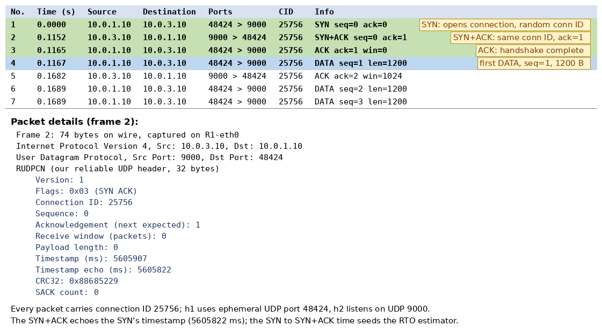{width=92%}

*Figure 2: connection set-up in handshake.pcapng. SYN, SYN+ACK and ACK carry the same connection ID; the first DATA packet has sequence 1.*

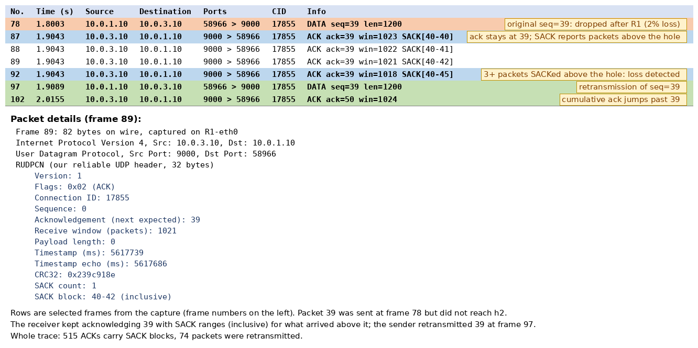{width=92%}

*Figure 3: loss recovery in loss-recovery.pcapng (selected frames). Packet 39 is lost; the receiver keeps acknowledging 39 while SACK reports 40 to 45; the sender retransmits 39 and the cumulative ACK jumps to 50.*

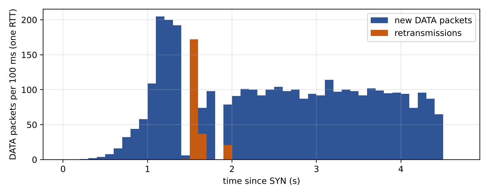{width=75%}

*Figure 4: DATA packets per 100 ms (one RTT) in window-growth.pcapng: 1, 2, 4, 8, 16, 32 in slow start, a burst of retransmissions when the window overshoots the bottleneck queue, then a steady rate of about 95 packets per RTT (about 9 Mbit/s).*

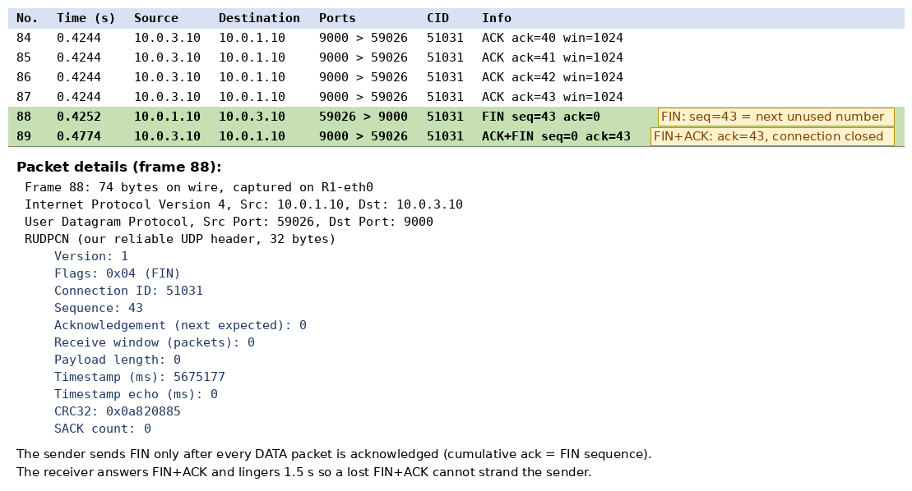{width=92%}

*Figure 5: teardown in teardown.pcapng. After the last DATA packet (seq 42) is acknowledged, the FIN carries sequence 43 and the FIN+ACK acknowledges 43.*

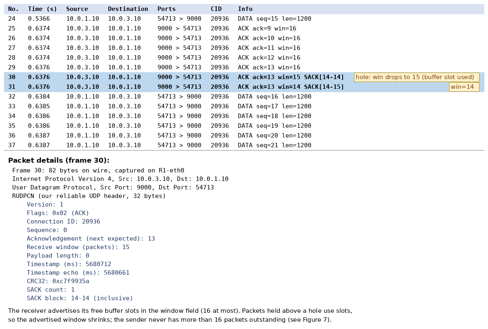{width=92%}

*Figure 6: flow control in flow-control.pcapng. With a 16-packet receive window, the advertised window falls from 16 to 15 and 14 as packets are buffered above the hole at 13.*

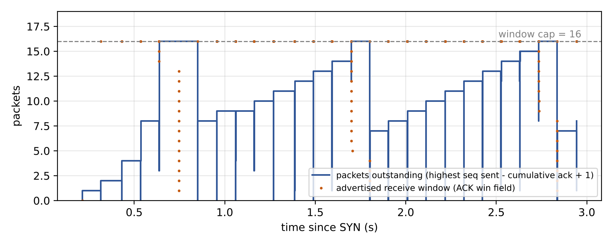{width=75%}

*Figure 7: packets outstanding and the advertised window over the first 3 s of flow-control.pcapng; the sender never exceeds the 16-packet window.*

# 7. Experimental method

Each condition runs in a freshly built network with the 100-packet bottleneck
queue. Every run sends a file of deterministic pseudo-random content with RUDP
(h1 to h2, SHA-256 checked), then the same number of bytes with TCP Reno and TCP
CUBIC (h3 to h4). Before each run, 20 pings from h1 to h2 on the idle path give
an RTT measured independently of RUDP. The final matrix uses **2 MiB per
transfer and 3 runs per condition** and reports mean and standard deviation;
failed transfers are kept in `raw.csv` and left out of the means.

| Experiment | Conditions (others: RTT 100 ms, 10 Mbit/s, 0% loss) | Metrics |
|---|---|---|
| Exp1 Loss | 0%, 2%, 5% loss per direction | Goodput, retransmissions, completion time |
| Exp2 Delay | RTT 20, 100, 200 ms | Goodput, RUDP RTT estimate vs ping RTT |
| Exp3 Rate | Bottleneck 5, 10, 20 Mbit/s | Goodput, cwnd over time, queueing delay |
| Exp4 Fairness | RUDP together with TCP Reno, and with TCP CUBIC; RTT 20, 100, 200 ms | Per-flow throughput, share, Jain's index |

*Table 6: experiment matrix. TCP Reno and CUBIC run under every Exp1 to Exp3 condition, which is the proposal's comparison experiment.*

**Goodput** is payload bytes divided by the time from the end of the handshake
to the acknowledged FIN for RUDP, and by the receiver-measured time from
accepting the connection to the last byte for TCP (`apps/tcp_bulk.py`). We
first used `iperf3 -n`, but it stops when the sender has written the bytes into
its socket buffer; on our bottleneck the receiver had counted only 12 to 87% of
a 2 MiB transfer, so the TCP numbers were meaningless. **Retransmissions** are
RUDP retransmitted packets and TCP `tcpi_total_retrans` from `TCP_INFO`.

**Fairness.** Both flows start together. Throughput is measured over the *same
window*, from when both are delivering until the first one finishes (RUDP from
its event log, TCP from the receiver's 0.5 s intervals), and Jain's index is
J = (x1 + x2)^2 / (2 (x1^2 + x2^2)): 1 for an equal split, 0.5 when one flow
takes everything. Measuring each flow over its own duration over-states
fairness, because the slower flow has the link to itself at the end; that value
is kept only for comparison.

# 8. Results

## 8.1 Topology and path verification (lab VM)

`topology/topo.py --check` builds the network, checks reachability and the
path, measures the RTT and the rate, and runs a 2 MiB RUDP transfer. Both
configurations passed every check.

| Check | 0% loss, RTT 50 ms, 10 Mbit/s | 2% loss per direction, RTT 50 ms, 10 Mbit/s |
|---|---|---|
| Ping h1 to h2 and h3 to h4 | 0.0% loss | 0.0% loss on the 3-packet reachability check |
| Traceroute h1 to h2 | 10.0.1.1, 10.0.2.2, 10.0.3.10 (54.2 ms) | 10.0.1.1, 10.0.2.2, 10.0.3.10 (57.6 ms) |
| Ping RTT (configured 50 ms) | 56.9 ms | 58.6 ms |
| Ping loss over 200 packets | 0.0% | 4.0% (expected about 4% round trip) |
| TCP throughput (iperf3) | 9.07 Mbit/s, 91% of the rate | 1.90 Mbit/s; Mathis model predicts 2.00 (95%) |
| RUDP 2 MiB transfer, SHA-256 | match, 7.51 Mbit/s in 2.23 s | match, 1.33 Mbit/s in 12.63 s |
| RUDP retransmissions / timeouts | 175 / 0 | 42 / 2 |
| RUDP min / smoothed RTT | 51.7 / 73.0 ms | 51.1 / 60.5 ms |

*Table 7: topology self-check on the lab VM (single run each).*

The traceroute proves that traffic crosses both routers. Ping RTT is about 7 ms
above the configured 50 ms, which is the cost of forwarding through the VM's
namespaces. The 175 retransmissions at 0% loss are all fast retransmits at the
end of slow start, where cwnd overshoots the bottleneck queue; no data is lost
to the link itself.

## 8.2 Live POC run (lab VM)

The demo transferred 30 MiB (31,457,280 bytes) in 73.9 s, 3.41 Mbit/s average
across the three phases, and the sent and received SHA-256 hashes matched
(`4c7fd09a...fb9c443`). The sender reported 279 retransmissions, 291
fast-retransmit detections, 1 timeout and 25,918 RTT samples (min 51.2 ms,
smoothed 211 ms at the end).

| Time | cwnd | ssthresh | State | What happened |
|---|---|---|---|---|
| 0.5 s | 122 | 1024 | slow start | Window doubling every RTT |
| 1.0 s | 173 | 173 | fast recovery | First drops at the full queue: cwnd halved once |
| 1.5 s | 86 | 86.7 | fast recovery | Packets sent after the first loss also dropped: a second event |
| 2.0 s | 44 | 44.5 | congestion avoidance | 232 retransmissions so far, all from the slow-start overshoot |
| 8.7 s | 115 | 44.5 | congestion avoidance | Linear growth, about +1 packet per RTT |
| 10 s | | | | 2% loss per direction added |
| 20 s | | | | RTT raised to 200 ms, loss removed |
| 72.0 s | 134 | 42.8 | congestion avoidance | Slow growth at the long RTT; 279 retransmissions in total |

*Table 8: congestion window during the live demo (from the live printout).*

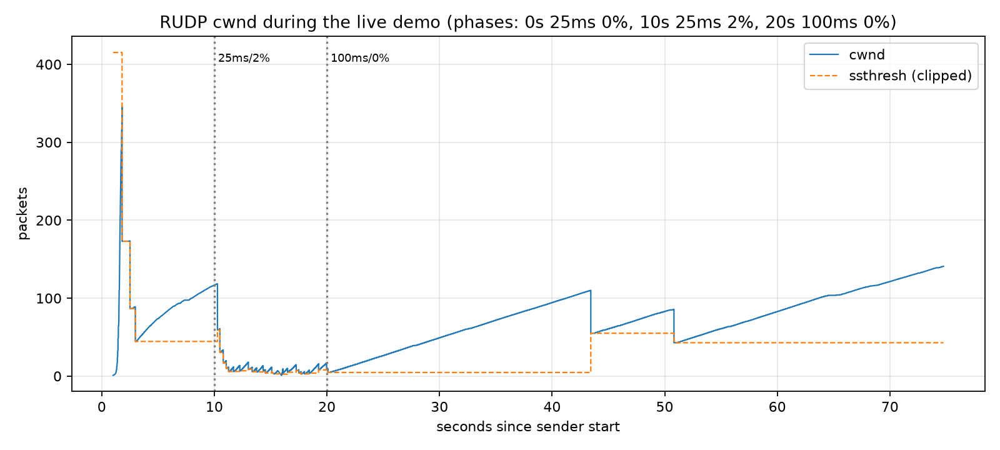{width=75%}

*Figure 8: cwnd and ssthresh during the live demo (results/demo/cwnd_demo.png), with the 10 s and 20 s network changes marked.*

The run shows each mechanism of Section 4: exponential growth in slow start,
fast retransmit with the window halved once per loss event, linear growth in
congestion avoidance, repeated halving in the 2% loss phase, and growth of only
about one packet per 200 ms RTT in the last phase. The RTO stayed between about
410 and 860 ms in the 200 ms phase, so the long-RTT phase had no spurious
timeouts after the fix in Section 4.4.

## 8.3 Trial experiment run (lab VM, 1 run, 2 MiB per transfer)

Before the full matrix we ran Exp3 and Exp4 once with 2 MiB transfers
(`run_experiments.py --only Exp3 Exp4 --runs 1 --payload-mib 2`). All 21
transfers completed and were verified. These are **single trial runs** and show
no spread; they check the pipeline and the direction of the results only.

| Bottleneck | RUDP Reno | TCP Reno | TCP CUBIC | RUDP / TCP Reno |
|---|---|---|---|---|
| 5 Mbit/s | 3.88 Mbit/s (78%) | 4.60 (92%) | 4.60 (92%) | 0.84 |
| 10 Mbit/s | 6.36 Mbit/s (64%) | 8.16 (82%) | 8.32 (83%) | 0.78 |
| 20 Mbit/s | 8.08 Mbit/s (40%) | 9.52 (48%) | 6.06 (30%) | 0.85 |

*Table 9: Exp3 trial, RTT 100 ms, 0% loss, goodput (share of the bottleneck rate).*

| Competing TCP | RTT | RUDP | TCP | RUDP share | Jain, own durations | Jain, overlap window |
|---|---|---|---|---|---|---|
| Reno | 20 ms | 4.56 | 8.76 | 34% | 0.91 | 0.59 |
| Reno | 100 ms | 2.18 | 8.06 | 21% | 0.75 | 0.53 |
| Reno | 200 ms | 1.22 | 5.06 | 19% | 0.73 | 0.57 |
| CUBIC | 20 ms | 4.72 | 7.64 | 38% | 0.95 | 0.66 |
| CUBIC | 100 ms | 1.88 | 7.91 | 19% | 0.72 | 0.55 |
| CUBIC | 200 ms | 1.37 | 6.14 | 18% | 0.71 | 0.55 |

*Table 10: Exp4 trial, 10 Mbit/s, 0% loss. Goodput in Mbit/s over each flow's own duration; "own durations" values are upper bounds on fairness (Section 7).*

## 8.4 Full experiment results (lab VM, 3 runs per condition, 2 MiB per transfer)

The full matrix ran on the lab VM with `run_experiments.py --runs 3 --payload-mib 2`:
15 conditions, 117 transfers, **all 117 completed and verified**. Tables 12 to
16 give the mean and standard deviation over the three runs, produced by
`analysis/make_report_tables.py` from `results/full/summary.csv`.

| Condition | Protocol | OK | Goodput (Mbit/s) | Completion (s) | Retransmissions |
|---|---|---|---|---|---|
| 0% | RUDP | 3/3 | 6.50 ± 0.02 | 2.58 ± 0.01 | 224.0 ± 8.5 |
| 0% | TCP Reno | 3/3 | 8.50 ± 0.02 | 1.97 ± 0.00 | 193.7 ± 13.4 |
| 0% | TCP CUBIC | 3/3 | 7.40 ± 0.95 | 2.29 ± 0.27 | 66.7 ± 115.5 |
| 2% | RUDP | 3/3 | 0.94 ± 0.27 | 18.69 ± 4.96 | 33.0 ± 4.4 |
| 2% | TCP Reno | 3/3 | 1.01 ± 0.10 | 16.75 ± 1.70 | 28.3 ± 4.9 |
| 2% | TCP CUBIC | 3/3 | 0.94 ± 0.07 | 17.93 ± 1.31 | 32.0 ± 1.0 |
| 5% | RUDP | 3/3 | 0.40 ± 0.08 | 42.94 ± 8.38 | 99.3 ± 16.1 |
| 5% | TCP Reno | 3/3 | 0.54 ± 0.12 | 32.37 ± 6.80 | 70.3 ± 8.1 |
| 5% | TCP CUBIC | 3/3 | 0.50 ± 0.04 | 33.65 ± 3.08 | 70.3 ± 6.8 |

*Table 12: Exp1, packet loss (RTT 100 ms, 10 Mbit/s; loss per direction).*

| Condition | Protocol | OK | Goodput (Mbit/s) | Completion (s) | Retransmissions |
|---|---|---|---|---|---|
| 20 ms | RUDP | 3/3 | 7.04 ± 1.28 | 2.43 ± 0.40 | 98.3 ± 80.8 |
| 20 ms | TCP Reno | 3/3 | 8.24 ± 1.89 | 2.12 ± 0.55 | 86.0 ± 66.9 |
| 20 ms | TCP CUBIC | 3/3 | 9.23 ± 0.57 | 1.82 ± 0.12 | 3.7 ± 3.2 |
| 100 ms | RUDP | 3/3 | 5.69 ± 1.11 | 3.03 ± 0.66 | 203.0 ± 66.8 |
| 100 ms | TCP Reno | 3/3 | 8.16 ± 0.34 | 2.06 ± 0.09 | 184.3 ± 2.5 |
| 100 ms | TCP CUBIC | 3/3 | 7.86 ± 0.46 | 2.14 ± 0.13 | 147.0 ± 127.0 |
| 200 ms | RUDP | 3/3 | 4.57 ± 0.08 | 3.68 ± 0.07 | 236.0 ± 108.3 |
| 200 ms | TCP Reno | 3/3 | 7.03 ± 0.03 | 2.39 ± 0.01 | 249.3 ± 5.7 |
| 200 ms | TCP CUBIC | 3/3 | 6.85 ± 0.26 | 2.45 ± 0.09 | 283.7 ± 33.3 |

*Table 13: Exp2, round-trip time (0% loss, 10 Mbit/s).*

| RTT | RUDP smoothed RTT (ms) | RUDP minimum RTT (ms) | Ping average ± sd (ms) | Ping minimum (ms) |
|---|---|---|---|---|
| 20 ms | 75.8 | 20.9 | 25.4 ± 4.6 | 20.4 |
| 100 ms | 109.8 | 101.0 | 124.3 ± 27.8 | 100.5 |
| 200 ms | 235.3 | 201.7 | 206.6 ± 6.0 | 200.5 |

*Table 14: RUDP's RTT estimate against the RTT measured by ping on the idle path.*

| Condition | Protocol | OK | Goodput (Mbit/s) | Completion (s) | Retransmissions |
|---|---|---|---|---|---|
| 5 Mbit/s | RUDP | 3/3 | 3.86 ± 0.10 | 4.35 ± 0.11 | 176.0 ± 16.6 |
| 5 Mbit/s | TCP Reno | 3/3 | 4.57 ± 0.03 | 3.67 ± 0.03 | 150.7 ± 9.3 |
| 5 Mbit/s | TCP CUBIC | 3/3 | 4.62 ± 0.04 | 3.63 ± 0.03 | 45.0 ± 6.2 |
| 10 Mbit/s | RUDP | 3/3 | 5.28 ± 2.08 | 3.67 ± 1.87 | 304.7 ± 142.3 |
| 10 Mbit/s | TCP Reno | 3/3 | 6.66 ± 1.68 | 2.63 ± 0.64 | 195.7 ± 10.0 |
| 10 Mbit/s | TCP CUBIC | 3/3 | 7.30 ± 1.48 | 2.37 ± 0.53 | 146.3 ± 127.0 |
| 20 Mbit/s | RUDP | 3/3 | 8.88 ± 0.41 | 1.89 ± 0.09 | 182.3 ± 12.9 |
| 20 Mbit/s | TCP Reno | 3/3 | 12.65 ± 0.83 | 1.33 ± 0.09 | 174.0 ± 124.3 |
| 20 Mbit/s | TCP CUBIC | 3/3 | 13.85 ± 0.28 | 1.21 ± 0.02 | 294.0 ± 33.5 |


*Table 15: Exp3, bottleneck rate (RTT 100 ms, 0% loss).*

| Competing TCP | RTT | RUDP goodput (Mbit/s) | TCP goodput (Mbit/s) | RUDP share while both run | Jain's index (overlap window) |
|---|---|---|---|---|---|
| Reno | 20 ms | 4.78 ± 0.19 | 7.15 ± 1.74 | 25.7 ± 21.0% | 0.773 ± 0.205 [0.600-1.000] |
| Reno | 100 ms | 2.59 ± 0.24 | 7.13 ± 0.98 | 8.6 ± 1.8% | 0.593 ± 0.021 [0.570-0.611] |
| Reno | 200 ms | 1.28 ± 0.10 | 5.85 ± 1.63 | 4.2 ± 0.2% | 0.544 ± 0.002 [0.542-0.545] |
| CUBIC | 20 ms | 4.71 ± 0.54 | 6.87 ± 1.91 | 29.1 ± 23.7% | 0.779 ± 0.178 [0.664-0.984] |
| CUBIC | 100 ms | 2.39 ± 0.00 | 7.93 ± 0.17 | 5.8 ± 0.4% | 0.562 ± 0.004 [0.557-0.565] |
| CUBIC | 200 ms | 1.33 ± 0.04 | 6.48 ± 0.10 | 4.4 ± 0.2% | 0.546 ± 0.002 [0.544-0.548] |

*Table 16: Exp4, RUDP sharing a 10 Mbit/s bottleneck with TCP (0% loss). Goodput over each flow's own duration; share and Jain's index over the window where both flows run (mean ± sd, range in brackets).*

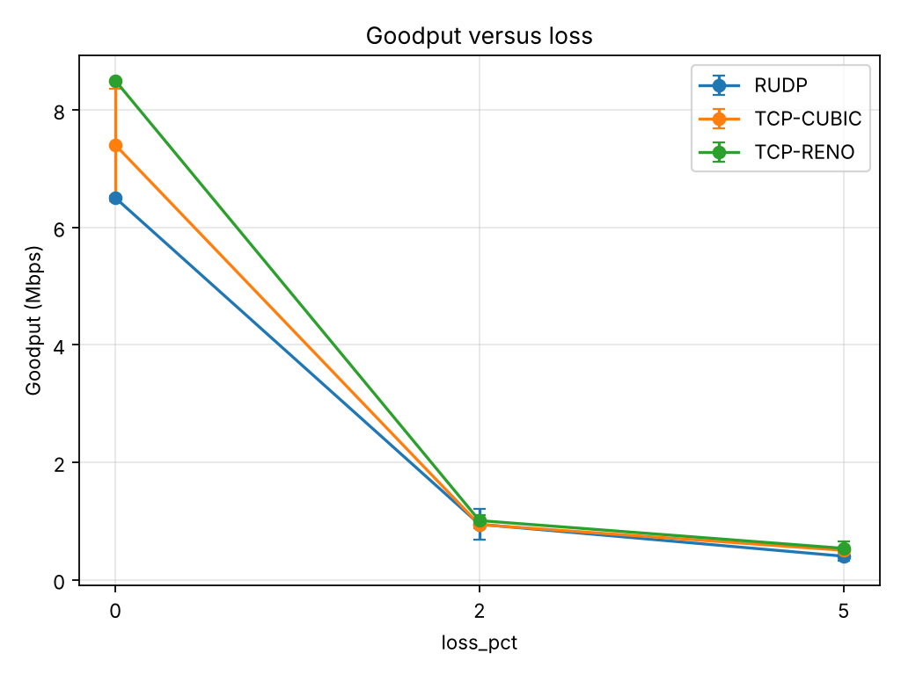{width=62%}

*Figure 9: goodput against loss (Exp1), mean and standard deviation of three runs.*

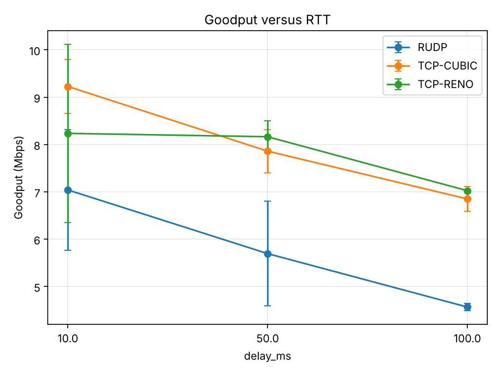{width=62%}

*Figure 10: goodput against RTT (Exp2).*

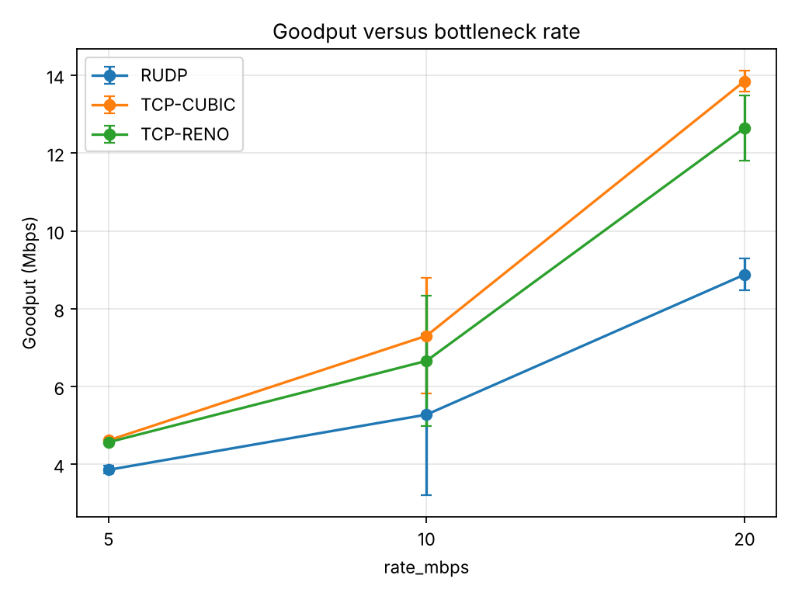{width=62%}

*Figure 11: goodput against bottleneck rate (Exp3).*

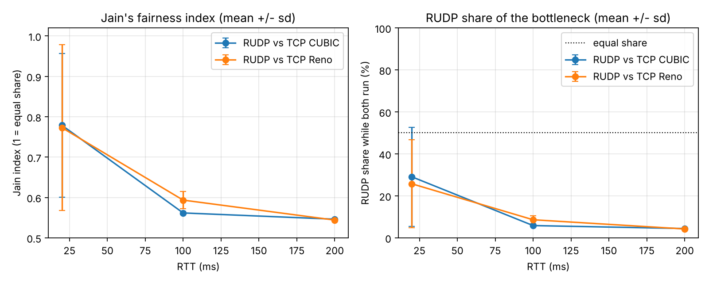{width=90%}

*Figure 12: RUDP's share and Jain's index against TCP Reno and TCP CUBIC at three RTTs (Exp4).*

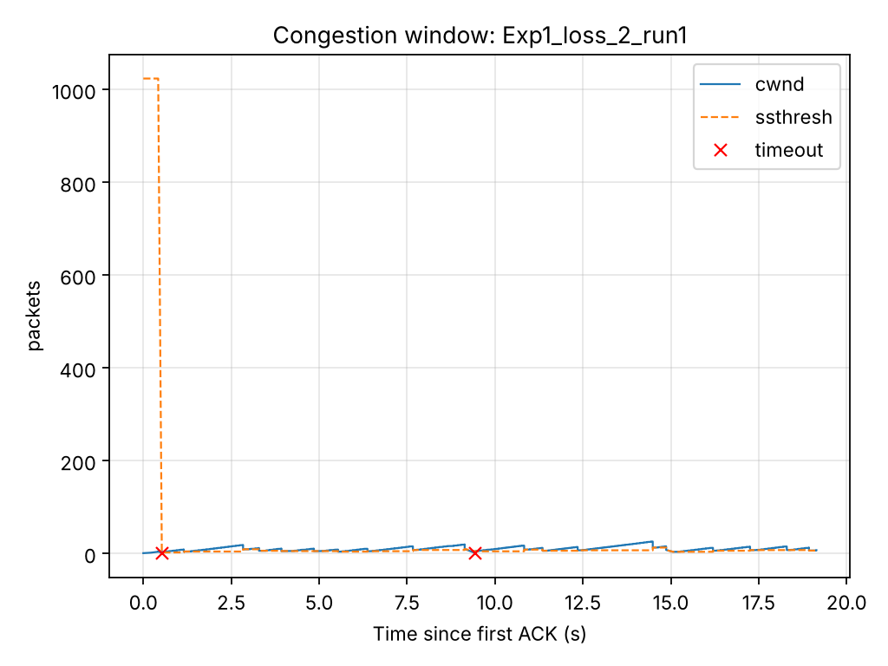{width=62%}

*Figure 13: RUDP cwnd and ssthresh in Exp1 at 2% loss (run 1): the Reno sawtooth.*

## 8.5 Discussion

**Correctness.** All 117 transfers of the full matrix, the 21 trial transfers,
both self-checks and the 30 MiB demo delivered files with a matching SHA-256,
including at 5% loss on data and ACKs.

**Loss (Exp1).** Goodput falls steeply with loss for every protocol: RUDP from
6.50 to 0.94 to 0.40 Mbit/s at 0, 2 and 5% loss, TCP Reno from 8.50 to 1.01 to
0.54. Under loss RUDP is close to TCP (within the run-to-run spread at 2%; about a quarter
lower at 5%), which is what a Reno-style controller should do: throughput is
set by the loss rate and RTT (Mathis model), not by the protocol. At 0% loss the
gap is larger, for the reason below.

**Efficiency without loss (Exp2, Exp3).** RUDP reached 65 to 85% of TCP Reno's goodput
on loss-free paths (for example 6.50 against 8.50 Mbit/s at 100 ms, 3.86
against 4.57 at 5 Mbit/s). With 2 MiB transfers most of the time is start-up:
RUDP's slow start overshoots the 100-packet queue (about 100 to 300
retransmissions at the end of slow start, Tables 12 and 15) and the two halvings
leave cwnd below the path's capacity, while Linux TCP limits the overshoot with
HyStart and pacing. The live demo (Table 8) shows the same pattern on a longer
transfer.

**RTT estimation (Exp2).** RUDP's minimum RTT matches ping's minimum within
1 ms at all three RTTs (20.9 against 20.4, 101.0 against 100.5, 201.7 against
200.5 ms). The smoothed RTT is higher because it includes queueing at the
bottleneck while the window is large: about 55 ms at 20 ms RTT and 90 ms at
5 Mbit/s (Table 15), where a 100-packet queue drains slowly.

**Fairness (Exp4).** RUDP is not aggressive towards TCP; the opposite holds.
At 20 ms RTT the two flows share the link reasonably (Jain 0.77 to 0.78, with a
wide spread between runs), but at 100 and 200 ms RUDP gets only 4 to 9% of the
link while both run and Jain's index falls to 0.54 to 0.59, close to the 0.5 of
one flow taking everything. RUDP's slow start loses many packets at the shared
queue and then grows by one packet per RTT, while TCP fills the queue first. The
result is the same against Reno and CUBIC. A HyStart-style slow-start exit is
the obvious next improvement.

# 9. Expected outcomes compared with results

| Expected in the proposal | Outcome |
|---|---|
| Correct delivery under loss, reordering and delay across the routed path | Met: every transfer verified by SHA-256 (Sections 8.1 to 8.3); reordering, duplication and corruption covered by the test suite |
| Goodput falls as loss rises, compared with TCP rather than assumed equal | Met: Table 12 and Figure 9 |
| A clear cwnd sawtooth | Met in the live demo (Table 8) |
| A measured fairness result | Met: Jain 0.54 to 0.78 over three runs (Table 16) |
| Captures, tables, report and README | Delivered (Sections 6, 8 and 10) |

# 10. Reproducibility and validation

The repository `README.md` gives the full procedure. In short, on Ubuntu 22.04
or 24.04:

```bash
git clone https://github.com/GhufranMianoor/RUDP.git && cd RUDP
sudo scripts/setup_ubuntu.sh            # Mininet, tc, Wireshark, Python venv
.venv/bin/python -m pytest -q            # 89 automated tests
sudo .venv/bin/python topology/topo.py --delay 25ms --loss 0% --rate 10mbit --check
sudo .venv/bin/python tools/live_demo.py --pause        # live POC
sudo .venv/bin/python tools/capture_evidence.py         # five .pcapng traces
sudo scripts/run_all.sh                  # full matrix, tables and plots
```

**Tests.** The 89 automated tests cover packet encoding and corruption, the
sender scoreboard and receiver state, RTT sampling with Karn's rule and the RTO
margin, Reno and CUBIC transitions (including one response per loss event and
per timeout episode), the TCP baseline tool, the overlap-window fairness
calculation, and localhost transfers through an impairment proxy with loss,
duplication, reordering, corruption and loss of SYN, SYN+ACK, FIN and FIN+ACK.

**Limitations.** Loss is applied in both directions, so ACKs are lost too.
RTT is sampled from local send times, so samples taken after a hole fills can
include recovery time. RUDP runs in user-space Python; it is fast enough for
these 5 to 20 Mbit/s bottlenecks but not for gigabit links. Slow start has no
HyStart-style early exit, which explains most of the gap to Linux TCP (Section
8.5). Transfers in the full matrix were 2 MiB, so start-up behaviour weighs more than it would in long transfers. Mininet and `tc` need a root Ubuntu environment.

# 11. Team members and contributions

| Member | Roll no. | Responsibilities |
|---|---|---|
| Muhammad Ghufran | 24K-0541 | Protocol specification and packet format; Selective Repeat sender and receiver, SACK and reorder buffer; sliding window and flow control; handshake and teardown |
| Ahmed Khan | 24K-0629 | RTT estimation and adaptive timeout; Reno congestion control with cwnd logging; CUBIC variant; lab VM runs |
| Shayan Khan | 24K-0669 | Routed topology and impairments; experiment runner and TCP baselines; packet captures and Wireshark dissector; fairness test and analysis |

*Table 17: contributions, following the proposal's division of work.*

# 12. Use of AI tools

An AI assistant was used for code review, help with debugging, and drafting
and formatting parts of this report. All experiments, packet captures and the
live demonstration were run by the team on our own lab VM, and every number in
this report comes from those runs. The team reviewed, tested and understood all
code and text before submission.

# 13. Deliverables

Source code (`rudp/`, `apps/`); topology (`topology/topo.py`); live demo
(`tools/live_demo.py`); captures (`tools/capture_evidence.py`,
`results/pcaps/`, `results/evidence/`) and dissector
(`tools/rudp_dissector.lua`); experiments and analysis
(`experiments/run_experiments.py`, `analysis/`, `results/`); architecture
(`docs/ARCHITECTURE.md`, `docs/figures/`); tests (`tests/`); reproduction
(`README.md`, `scripts/`).
