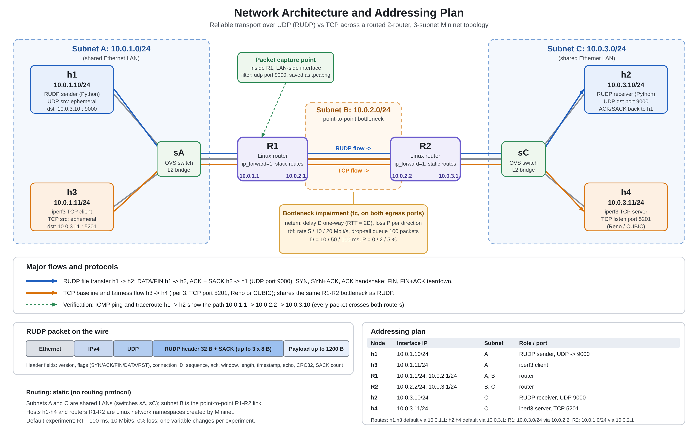
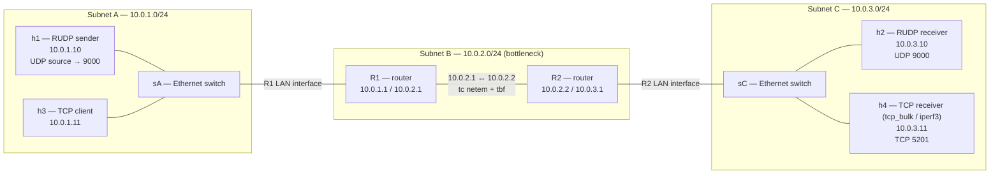

# Network Architecture and Addressing Plan

This is the approved routed design from the CS3001 proposal: two Linux routers,
three IPv4 subnets, a RUDP transfer, and a competing TCP flow.

## Topology



Figure 1 (`docs/figures/architecture.svg` is the editable source, `architecture.png` the
image for the report). The Mermaid sketch below is kept as a text-diffable summary.



### Addressing and ports

| Node | Interface | Address | Role / ports |
|---|---|---|---|
| h1 | h1-eth0 | 10.0.1.10/24 | RUDP sender, destination UDP 9000 |
| h3 | h3-eth0 | 10.0.1.11/24 | TCP client |
| R1 | R1-eth0 | 10.0.1.1/24 | Router, subnet A |
| R1 | R1-eth1 | 10.0.2.1/24 | Router, subnet B |
| R2 | R2-eth0 | 10.0.2.2/24 | Router, subnet B |
| R2 | R2-eth1 | 10.0.3.1/24 | Router, subnet C |
| h2 | h2-eth0 | 10.0.3.10/24 | RUDP receiver, UDP 9000 |
| h4 | h4-eth0 | 10.0.3.11/24 | TCP receiver (`apps/tcp_bulk.py`; iperf3 for the rate check), TCP 5201 |

Subnet A is a shared Ethernet LAN through sA; subnet C is a shared Ethernet
LAN through sC. Subnet B is the point-to-point R1–R2 link. This is necessary
for multiple hosts to share each /24 subnet without assigning the same router
IP address to multiple physical interfaces. The switches are Open vSwitch
learning bridges (`OVSBridge`, no controller); they are named `sA`/`sC` with
explicit datapath IDs because Mininet refuses non-`s<number>` names without one.
Router interface names are looked up from the links rather than assumed
(Mininet sorts links, so `R1-eth0`/`R1-eth1` numbering is not guaranteed).

## Communication flows

1. RUDP data: h1:ephemeral-UDP → h2:9000, routed through R1 and R2.
   Replies/ACKs travel from h2:9000 back to h1's ephemeral UDP port.
2. TCP baseline: h3:ephemeral-TCP → h4:5201, routed through R1 and R2.
3. Routing: h1/h3 use default gateway 10.0.1.1; h2/h4 use 10.0.3.1.
   R1 has a route to 10.0.3.0/24 via 10.0.2.2; R2 has a route to
   10.0.1.0/24 via 10.0.2.1.
4. Impairments: configured with `tc` on the two egress interfaces of the
   bottleneck (R1's and R2's interface on subnet B, `R1-eth1` / `R2-eth0` in the
   current Mininet numbering):
   - `netem delay D loss P limit 10000` as the root qdisc, and
   - `tbf rate R burst B limit L` as its child (`parent 1:1`).
   `D` is one-way delay on each egress, so RTT = 2D. `P` is loss **per
   direction**: data and ACKs are each lost with probability P, so a ping round
   trip sees about 1-(1-P)^2, roughly 2P. `L` is the drop-tail queue,
   100 MTU-sized packets (150 000 bytes) by default; `B` is
   max(15 000 B, rate/100), which is at least rate/HZ and one MTU so that tbf can
   actually reach the configured rate. Offloads (TSO/GSO/GRO) are disabled so
   the queue sees real packets.
5. Captures: taken inside R1 on its LAN-side interface (the sender's side of the
   bottleneck). Every transmission, including the original of a packet the
   bottleneck later drops and every retransmission, plus all returning ACKs and
   SACK blocks, is visible there. A capture on the R1-R2 interface would not
   show packets the queue dropped.

## Important protocol distinction

RUDP is an application-level protocol carried inside UDP. The outer IP/UDP
headers identify the hosts and UDP ports; the custom RUDP header carries
connection ID, flags, sequence/acknowledgement numbers, receive window,
timestamps, checksum, and SACK information. TCP comparison traffic is a
separate flow and is not encapsulated in RUDP.

## Verification

Run the topology check on the Ubuntu/Mininet host:

```bash
sudo .venv/bin/python topology/topo.py --delay 10ms --loss 0% --rate 10mbit --check
```

The check prints addresses, routes and `tc -s qdisc`, then asserts:

1. `ping` h1 -> h2 and h3 -> h4 succeed;
2. `traceroute` from h1 shows `10.0.1.1`, `10.0.2.2`, `10.0.3.10`;
3. ping RTT matches 2 x `--delay` (within 20% + 6 ms);
4. iperf3 TCP h3 -> h4 reaches at least 80% of `--rate`; with loss configured, 0.5x to 2x of
   the Mathis model's loss-limited rate (1.22 x MSS / (RTT x sqrt(p)), about 2 Mbit/s at 50 ms and 2%);
5. a 2 MiB RUDP transfer h1 -> h2 has an identical SHA-256.

It also prints the observed ping loss, for information only, because loss is
random. Do not describe the topology as live-verified on the lab machine until
this command has passed there.
