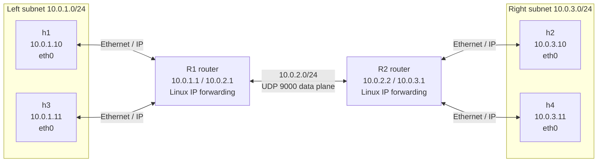

# RUDP Network Architecture and Addressing Plan

## Logical topology



## Addressing and services

| Device | Interface/subnet | Address | Default gateway | Role |
|---|---|---|---|---|
| h1 | left | 10.0.1.10/24 | 10.0.1.1 | RUDP/TCP sender and test source |
| h3 | left | 10.0.1.11/24 | 10.0.1.1 | Second source for fairness tests |
| R1 | left, WAN | 10.0.1.1/24, 10.0.2.1/24 | static routes | First Linux router and packet capture point |
| R2 | WAN, right | 10.0.2.2/24, 10.0.3.1/24 | static routes | Second Linux router and packet capture point |
| h2 | right | 10.0.3.10/24 | 10.0.3.1 | RUDP receiver and TCP server |
| h4 | right | 10.0.3.11/24 | 10.0.3.1 | Second receiver for fairness tests |

Static routes:

- R1: `10.0.3.0/24 via 10.0.2.2`
- R2: `10.0.1.0/24 via 10.0.2.1`
- h1/h3: `default via 10.0.1.1`
- h2/h4: `default via 10.0.3.1`

## Protocol flows

1. RUDP handshake:
   - h1 -> h2: UDP SYN, source ephemeral port -> destination UDP 9000
   - h2 -> h1: UDP SYN+ACK
   - h1 -> h2: UDP ACK
2. RUDP data: h1 sends DATA packets with 32-byte RUDP headers, sequence numbers,
   CRC32, timestamps, and optional SACK ranges.
3. RUDP acknowledgements: h2 returns ACK packets with cumulative acknowledgement,
   receive window, timestamp echo, and SACK ranges.
4. RUDP teardown:
   - h1 -> h2: UDP FIN
   - h2 -> h1: UDP ACK
5. TCP comparison: `iperf3` uses TCP/5001-ports; the experiment runner selects
   a distinct ephemeral client port and TCP Reno or CUBIC.

## Impairment points

Packet loss and delay are applied with Linux `tc netem` on R1 and R2 WAN
interfaces. Bottleneck bandwidth is applied with a TBF queue. This places
impairments in both routed directions and allows captures to see the full
handover, retransmission, and acknowledgement exchanges.

Capture the WAN interface with:

```bash
sudo tools/capture_runs.sh R1-eth3 results/pcaps 30
```
