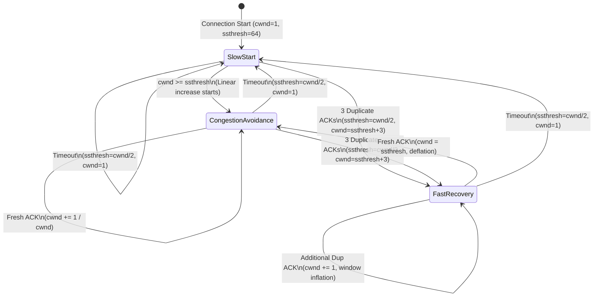

# Congestion Controller Interface and RTT Sampling Design

**Project**: Reliable Transport over UDP (RUDP)  
**Member 2**: Ahmed Khan (Roll No: 24K-0629)  
**Deliverable**: Week 1 — *RTT sampling hooks; study and design the congestion controller interface*

---

## 1. Executive Summary

This document specifies the architecture, formal interfaces, and mathematical foundations for:
1. **RTT Sampling Hooks & Karn's Algorithm** (RFC 6298): Accurate sender-side Round-Trip Time measurement that avoids the retransmission ambiguity problem.
2. **Congestion Controller Interface** (RFC 5681): An extensible protocol interface decoupling transport mechanics from congestion control algorithms (supporting `NullController`, `RenoController`, and future stretch goals such as `CubicController`).
3. **Structured Metrics & Telemetry**: JSON-lines event logging of congestion window (`cwnd`), slow-start threshold (`ssthresh`), controller state, and RTT samples for experimental evaluation across the routed topology.

---

## 2. Theoretical Study: Congestion Control & RTT Estimation

### 2.1 The Need for Transport Congestion Control
UDP provides best-effort datagram delivery without network feedback. Unregulated UDP flows injected into a network cause buffer overflows, queue bloat, packet drops, and severe throughput collapse. To achieve fair sharing and high utilization over bottleneck links (such as the R1–R2 router link in our 2-router topology), transport protocols must regulate their transmission rate according to network capacity.

Modern protocols like QUIC (RFC 9000/9002) and TCP (RFC 5681) regulate transmission using sliding window feedback:
$$\text{FlightSize} \le \min(cwnd, rwnd)$$
Where:
- $cwnd$ is the congestion window computed by the sender based on perceived network congestion.
- $rwnd$ is the receiver's advertised window for flow control.

### 2.2 RTT Estimation & The Retransmission Ambiguity Problem (RFC 6298)
To compute an adaptive retransmission timeout (RTO), the sender must measure Round-Trip Time (RTT). An RTT sample is the elapsed time between sending a segment and receiving its acknowledgement:
$$\text{SampleRTT} = t_{\text{ack}} - t_{\text{sent}}$$

#### The Retransmission Ambiguity Problem
When a packet is lost or delayed and subsequently retransmitted, if an acknowledgement for that sequence number arrives later:
- The sender cannot know whether the ACK was triggered by the original transmission or the retransmission.
- If the ACK was for the original packet (which was merely delayed), computing $t_{\text{ack}} - t_{\text{retransmit}}$ severely underestimates the true RTT.
- If the ACK was for the retransmission, computing $t_{\text{ack}} - t_{\text{original}}$ severely overestimates the RTT.

#### Karn's Algorithm (RFC 6298 Section 3)
To prevent corrupted RTO calculations, Karn's Algorithm establishes the rule:
> **Do not measure SampleRTT for any segment that has been retransmitted.**

RTT samples must strictly be collected **only** for segments transmitted exactly once.

---

## 3. RTT Sampling Architecture (`rudp.rtt`)

The `RTTSampler` class encapsulates transmission tracking and sample extraction adhering to Karn's algorithm.

```
       Packet Sent (1st time)
Sender ------------------------> [RTTSampler: Track t_sent, retransmitted=False]
                                        |
       If Retransmitted                 v
Sender ------------------------> [Mark retransmitted=True, count++]
                                        |
       When ACK Received                v
Sender ------------------------> [Check retransmitted?]
                                  /            \
                       True (Ambiguous)    False (Clean Sample)
                             /                    \
                   Discard sample,            Calculate SampleRTT = t_ack - t_sent,
                   ambiguous_count++          Update RTTStats,
                   Return None                Notify observers,
                                              Return SampleRTT
```

### 3.1 Public Interface of `RTTSampler`
- `on_packet_sent(sequence: int, timestamp: float | None = None)`: Records initial send time or updates existing tracking.
- `on_packet_retransmitted(sequence: int, timestamp: float | None = None)`: Explicitly flags sequence as retransmitted (disqualifies from future RTT sampling).
- `on_packet_acked(sequence: int, timestamp: float | None = None) -> float | None`: Returns validated `SampleRTT` in seconds, or `None` if retransmitted or untracked.
- `add_observer(callback)`: Registers observers for telemetry/live metrics.
- `stats`: Returns `RTTStats(sample_count, ambiguous_count, latest_rtt, min_rtt, max_rtt, mean_rtt)`.

---

## 4. Congestion Controller Interface Design (`rudp.controller`)

### 4.1 Interface Specification (`CongestionController`)
The protocol defines the complete lifecycle of transport events and controller queries:

```python
class CongestionController(Controller, Protocol):
    @property
    def cwnd(self) -> float: ...
    @property
    def ssthresh(self) -> float: ...
    @property
    def state(self) -> CongestionState: ...
    def window(self) -> int: ...
    def rto(self) -> float: ...

    def on_packet_sent(self, sequence: int, size: int = 1) -> None: ...
    def on_ack(self, sequence: int, rtt: float | None = None) -> None: ...
    def on_duplicate_ack(self, ack_number: int) -> bool: ...
    def on_loss(self, sequence: int) -> None: ...
    def on_rto_timeout(self) -> None: ...
    def stats(self) -> dict[str, Any]: ...
```

### 4.2 State Machine: TCP Reno (RFC 5681)

TCP Reno defines three operational states:
1. **Slow Start (SS)**: Exponential growth phase.
   - Initial $cwnd = 1.0$ packet (SMSS).
   - For every valid ACK received:
     $$cwnd \leftarrow cwnd + 1.0$$
   - When $cwnd \ge ssthresh$, transition to **Congestion Avoidance**.

2. **Congestion Avoidance (CA)**: Linear growth phase (AIMD).
   - For every valid ACK received:
     $$cwnd \leftarrow cwnd + \frac{1}{\lfloor cwnd \rfloor}$$
   - Over one RTT window ($\lfloor cwnd \rfloor$ ACKs), $cwnd$ increases by $+1.0$ packet.

3. **Fast Retransmit & Fast Recovery (FR)**:
   - Triggered upon receiving $3$ consecutive duplicate ACKs:
     $$ssthresh \leftarrow \max\left(2.0, \left\lfloor \frac{cwnd}{2} \right\rfloor \right)$$
     $$cwnd \leftarrow ssthresh + 3.0$$
   - While in Fast Recovery:
     - Additional duplicate ACKs inflate window: $cwnd \leftarrow cwnd + 1.0$
     - Arrival of a fresh ACK acknowledging new data deflates window:
       $$cwnd \leftarrow ssthresh$$
       State returns to **Congestion Avoidance**.

4. **Retransmission Timeout (Severe Congestion)**:
   - When an RTO timer expires without ACKs:
     $$ssthresh \leftarrow \max\left(2.0, \left\lfloor \frac{cwnd}{2} \right\rfloor \right)$$
     $$cwnd \leftarrow 1.0$$
     $$dup\_acks \leftarrow 0$$
   - State resets to **Slow Start**.

### 4.3 Reno State Diagram



---

## 5. Structured Event Logging & Observability

To satisfy the evaluation metrics in the proposal (tracking $cwnd$ over time, queue-induced delay, and goodput), `RenoController` integrates with `rudp.eventlog.EventLogger`.

Every state change or window adjustment logs a JSON-lines record:
```json
{
  "time": 1793962800.123,
  "event": "congestion_event",
  "trigger": "slow_start_ack",
  "cwnd": 4.0,
  "window": 4,
  "ssthresh": 32.0,
  "state": "slow_start",
  "dup_acks": 0,
  "rto": 0.25,
  "sequence": 3,
  "rtt": 0.0215
}
```

This telemetry feeds directly into Member 3's analysis scripts and Member 2's Week 5 cwnd sawtooth graphs.

---

## 6. Implementation Files for Member 2 (Week 1)

| File | Purpose |
|------|---------|
| `rudp/rtt.py` | `RTTSampler`, `RTTSample`, `RTTStats`, Karn's algorithm implementation. |
| `rudp/controller.py` | `CongestionController` protocol, `CongestionState`, `NullController`, and `RenoController`. |
| `rudp/hooks.py` | Unified export of controllers and RTT hooks for backward compatibility. |
| `rudp/sender.py` | Sender integration with `RTTSampler` and duplicate ACK signalling. |
| `rudp/connection.py` | Pluggable controller parameter in `Connection`. |
| `apps/send_file.py` | CLI flags `--cc {reno,null}` and `--log` for experiment runs. |
| `tests/test_rtt.py` | 7 unit tests verifying RTT sampling, Karn's algorithm, and edge cases. |
| `tests/test_controller.py` | 7 unit tests verifying Slow Start, Congestion Avoidance, Fast Retransmit, Recovery, and Timeout. |
| `tests/test_sender.py` | Expanded sender tests testing RTT integration, Karn's algorithm, and Reno dynamics. |

---

## 7. Roadmap for Subsequent Weeks (Member 2)

- **Week 2: RTO Estimation, Backoff, and Timer Management**:
  - Implement Jacobson's algorithm (RFC 6298):
    $$SRTT \leftarrow (1 - \alpha) \cdot SRTT + \alpha \cdot SampleRTT \quad (\alpha = 1/8)$$
    $$RTTVAR \leftarrow (1 - \beta) \cdot RTTVAR + \beta \cdot |SRTT - SampleRTT| \quad (\beta = 1/4)$$
    $$RTO \leftarrow SRTT + \max(G, 4 \cdot RTTVAR)$$
  - Exponential timer backoff ($RTO \leftarrow 2 \times RTO$) on timeout.
  - Per-packet timer / earliest-deadline retransmission queue.
- **Week 3: Slow Start, Congestion Avoidance, Fast Retransmit & Recovery Tuning**:
  - Full end-to-end integration across routed topology with Member 3.
  - Verification of cwnd sawtooth pattern under packet loss.
- **Week 4: Tuning and Stretch Goal (CUBIC-style variant)**:
  - Implementation of `CubicController` ($W_{cubic}(t) = C(t - K)^3 + W_{max}$).
- **Week 5: CWND and RTT Results Analysis**:
  - Plotting cwnd over time, queue delay analysis, technical report contribution.


## 8. Loss detection and recovery as implemented (final)

The sender (`rudp/sender.py`) drives the controller; the controller never
inspects packets. The behaviour below supersedes the pure duplicate-ACK
description in section 4.2 wherever they differ.

**SACK scoreboard.** Packets covered by a cumulative ACK or a SACK block leave
the outstanding set; SACKed sequence numbers are remembered. An outstanding
packet is declared *lost* when three packets above it have been SACKed
(`DUP_ACK_THRESHOLD`). A retransmitted packet is re-declared lost only when
three packets sent *after* its retransmission were SACKed first, so a single
loss does not trigger an endless retransmission loop. A SACK-free ACK that
repeats the cumulative ACK still counts as a classic duplicate ACK.

**One congestion response per window.** `Sender._recovery_point` is
`next_sequence` at the moment a loss event is reported. Losses of packets sent
before that point belong to the same event and do not reduce the window again.
`RenoController.on_fast_retransmit()` sets `ssthresh = max(2, cwnd/2)`,
`cwnd = ssthresh` and enters Fast Recovery; it does **not** collapse cwnd to 1
or back off the RTO. When the cumulative ACK passes `_recovery_point` the sender
calls `on_recovery_complete()` and Reno returns to Congestion Avoidance.

**Timeouts.** One RTO episode (all packets whose timer expired together) calls
`on_loss()` once: `ssthresh = max(2, cwnd/2)`, `cwnd = 1`, RTO doubled
(bounded by `MAX_RTO`). Lost packets are not "in flight"; they wait in a queue
and are retransmitted only as the window allows, so a timeout while cwnd = 1
sends one packet, not the whole window.

**Timing.** Initial RTO 1 s (RFC 6298), seeded by the handshake RTT, then
`srtt + 4 * rttvar` clamped to [`MIN_RTO` 0.2 s, `MAX_RTO` 5 s]. The sender waits
on the socket only until the next timer could fire. RTT samples come from
sender-local send times with Karn's algorithm (retransmitted packets are never
sampled). The `timestamp` field of every transmission, including
retransmissions, is freshly stamped and echoed in `timestamp_echo`; the echo is
carried for packet-capture analysis and is not what the sender uses to sample RTT.

**Window.** The receive window / maximum sequence span is 1024 packets, above
the largest bandwidth-delay product tested (20 Mbit/s x 200 ms is about 420
packets), so cwnd rather than the flow-control window limits throughput. The
initial `ssthresh` equals the window cap, so slow start runs until the first loss.

**SACK ordering.** The receiver reports the three most recently updated
out-of-order ranges, newest first (RFC 2018), as inclusive `(start, end)` pairs.
